# Jarviee

A local command center for AI coding agents. It picks the right model for each task, runs the agents for you, and shows all of them on one dashboard.

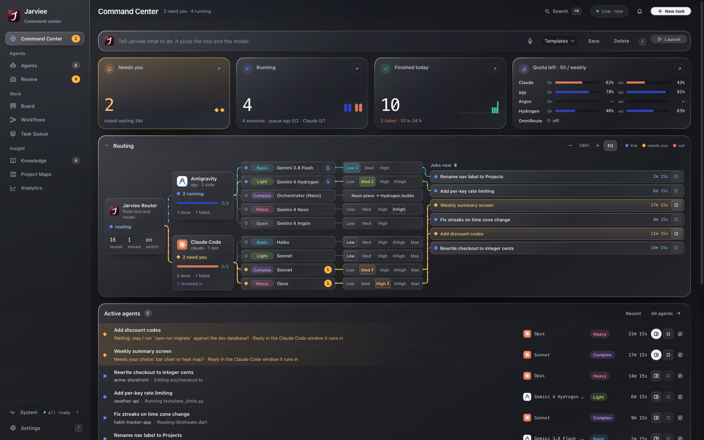

Jarviee works with two agent CLIs: Claude Code (`claude`) and Antigravity (`agy`). Python 3.9+, standard library only, no build step.

## What it does

- **Auto-routing.** Every task is classified into one of four levels (basic, light, complex, heavy) and started on the model and effort that fit it. Renames and typos go to a cheap model; refactors and hard debugging go to a strong one.
- **One dashboard for every running agent.** Status, current activity, model, steps, elapsed time, a "needs you" group, and usage / quota for both tools. Agents you start yourself in the apps show up too, through hooks.
- **`/orchestrate`.** A lead agent splits a task and hands it to up to 7 workers in a 4×2 iTerm2 grid, reviews their results, and sends rework back.
  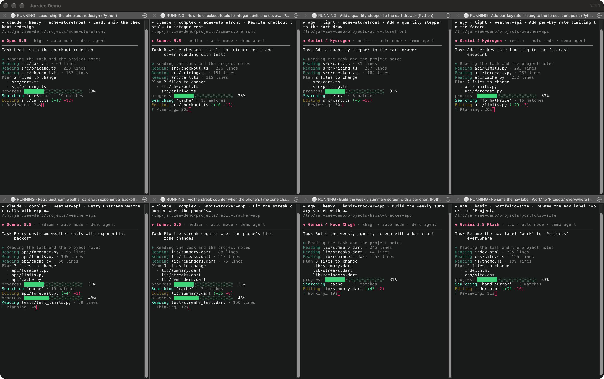
- **`/pipeline`.** An opt-in chain of separate agents: research, plan, build (and optional review).
- **Cross-tool fallback.** When a quota runs out or a CLI is missing, the task moves to the other tool. An optional local OmniRoute gateway is the last resort.
- **Project brains.** Jarviee reads each project's `.brain/` notes and adds them to the prompt as context, and keeps a project map (`.brain/FLOW.json`) you can browse.
- **Kanban board** per project, and a **review inbox** for finished runs.
- **Phone push notifications** through [ntfy](https://ntfy.sh), and **spoken reports** in a local voice (the "Jarviee" voice). Both are off until you turn them on.
- **`/startwork` and `/endwork`.** A morning briefing (calendar, mail, GitHub, WhatsApp, agents) and an end-of-day report.

## Runs on your machine, with your accounts

> - The server binds to `127.0.0.1` only. Nothing is reachable from your network.
> - Jarviee ships with **no API keys, no accounts and no subscriptions**.
> - It launches the `claude` and `agy` CLIs **you** installed and signed into. All usage is billed to **your** plans.
> - Your data stays in `~/.jarviee` on your machine.
> - Every connector (phone, mail, calendar, WhatsApp, voice, OmniRoute) is **off until you turn it on**.
> - Nothing is sent to the author. There is no telemetry.

## Read this before you run it

> **Token use.** The first project map reads a whole project and can use a lot of tokens. Map one project at a time. Automatic map updates are off by default. Over time routing saves tokens: simple tasks go to cheap models, and the brain notes give agents context so they do not re-read the whole project on every prompt.
>
> **System load.** Jarviee runs several agent CLIs in parallel (up to 8 with `/orchestrate`), background watchers and a local server. Expect real CPU, RAM and battery use. 16 GB of RAM is recommended for `/orchestrate`.
>
> **Auto-approve permissions.** Agents run with auto-approve permission modes (`claude --permission-mode auto`, `agy --mode auto`). They edit files and run commands in your projects without asking. Use git and review the changes. Only point Jarviee at projects and prompts you trust.
>
> **macOS first.** Most features are built and tested on macOS. See [docs/PLATFORM_SUPPORT.md](docs/PLATFORM_SUPPORT.md) for what works where.
>
> **As is.** Jarviee is provided as is, under the MIT license, with no warranty. It is not affiliated with, endorsed by or sponsored by Anthropic or Google.

## Requirements

- Python 3.9 or newer.
- At least one agent CLI, installed and signed in by you: Claude Code (`claude`) or Antigravity (`agy`). Both is better: that is what makes routing and fallback useful.
- macOS for the full experience. iTerm2 is needed for the live agent panes; without it runs happen in the background and still show on the dashboard. See [docs/PLATFORM_SUPPORT.md](docs/PLATFORM_SUPPORT.md).
- Optional: `terminal-notifier` (clickable alerts), `gh` (GitHub in the briefing), the ntfy app (phone alerts), Piper or Kokoro (nicer voices).

## Quick start

```bash
git clone https://github.com/Mclein31/jarviee.git
cd jarviee
python3 hub.py setup      # detects your tools, asks for your projects folder, offers to install hooks
python3 hub.py doctor     # read-only health check
python3 hub.py serve      # then open http://127.0.0.1:7777
python3 hub.py run "hello" --tool echo --inline   # safe first try: a fake tool, nothing real runs, no tokens spent
```

`setup` writes only `~/.jarviee/config.json`. It never edits the repo's `config.json`. Use `--dry-run` to preview and `--yes` to accept the detected defaults.

Start the server before the agents you want to watch. If it is not running, the hooks quietly do nothing.

Optional, macOS:

```bash
python3 hub.py service install   # background service (launchd), starts at login
python3 hub.py app install       # ~/Applications/Jarviee.app launcher (Spotlight, Dock)
```

Try the router without starting anything:

```bash
python3 hub.py classify "rename getUser to fetchUser"
# tier: basic  →  agy · gemini-3.8-flash-low  effort low
```

## Connect your AI tools

Jarviee does not log in for you. Install and sign in to the CLIs yourself, then check that they work on their own:

```bash
claude --version     # Claude Code: sign in with `claude`
agy --version        # Antigravity: sign in with `agy`
python3 hub.py doctor
```

**With only one of them.** `setup` detects what is on your `PATH`. If only `claude` is installed, it points all four levels at Claude models; if only `agy`, at agy models. Nothing else needs to change, and the missing tool is simply never used. A missing binary at run time also falls back to the other tool.

**Customize models and dispatch.** Put overrides in `~/.jarviee/config.json`. It is deep-merged over the repo's `config.json`: objects merge, lists and values replace. For example, to send heavy tasks to Sonnet and give basic tasks to Claude Haiku:

```json
{
  "dispatch": {
    "basic": {"tool": "claude", "model": "haiku"},
    "heavy": {"tool": "claude", "model": "sonnet"}
  },
  "lanes": {"agy": 1, "claude": 2}
}
```

The full list of keys is in [docs/CONFIGURATION.md](docs/CONFIGURATION.md).

**Add another agent CLI.** Declare it under `"tools"`. Four placeholders are filled in at launch: `{prompt}`, `{model}`, `{effort}` and `{session}`.

```json
{
  "tools": {
    "mytool": {
      "command": ["mytool", "-p", "{prompt}", "--model", "{model}"],
      "models": {"basic": "fast", "light": "standard", "complex": "strong", "heavy": "max"},
      "efforts": {"basic": "low", "light": "medium", "complex": "high", "heavy": "high"},
      "effort_args": ["--effort", "{effort}"],
      "session_args": ["--session-id", "{session}"],
      "resume_args": ["--resume", "{session}"]
    }
  },
  "dispatch": {"light": {"tool": "mytool", "model": "standard"}}
}
```

`effort_args` is added to the command when the run has an effort. `session_args` and `resume_args` let a reply continue the same conversation. Hooks and read-only flags for a new CLI need a small code change; see [CONTRIBUTING.md](CONTRIBUTING.md).

## Connect your projects

A project is any folder directly under `obsidian.workspace_root` that has a `.brain/` folder. `setup` sets the root; to change it later, edit `~/.jarviee/config.json`:

```json
{"obsidian": {"workspace_root": "~/Projects"}}
```

Folders whose names start with `.` or `_` are skipped.

Start a project's notes with:

```bash
python3 hub.py brain init ~/Projects/my-app
```

It copies the starter files from `examples/brain-template/` into `my-app/.brain/` and never overwrites a file that exists.

What Jarviee does with a project's `.brain/`:

| It reads | Used for |
| --- | --- |
| `PROJECT_CONTEXT.md`, `TODO.md`, `DECISIONS.md` (the `obsidian.context_files` list) | Added to the prompt as context (frontmatter stripped, capped at `max_context_chars`) |
| `TODO.md` markers (`✅` done, `⬜` to do, `👤` needs you, `- [x]` / `- [ ]`) | Progress and items that need you on the dashboard |
| `ARCHITECTURE.md`, `TODO.md`, `PROJECT_CONTEXT.md` | Context for the planner |
| `_BRAIN/PROJECT_STATUS.md` in the workspace root (optional) | Status, focus and blocker per project |

What Jarviee writes in a project:

- A line in `.brain/AGENT_RUNS.md` when a launched run finishes.
- One `TODO.md` item ticked, only when you press **Done** on it in the dashboard (with an Undo).
- `.brain/FLOW.json`, the project map, written by a map agent and committed after Jarviee validates it. Run `/map my-app` to make or update one.
- `.brain/.locks/` files while queued tasks run, so two agents do not edit the same file.

Jarviee never writes to `_BRAIN/`. Runs that change files commit only the files that run changed, never `git add -A`.

## Slash commands

Type these in the dashboard's command bar. `/help` lists them. Flags: **agents** = starts an agent or a team; **tokens** = can use a lot of quota.

| Command | Arguments | What it does | Flags |
| --- | --- | --- | --- |
| `/help` | | List every slash command with its arguments. | |
| `/status` | | The fleet right now: running, needs you, failed in the last hour and queued tasks, per tool. | |
| `/standup` | `[YYYY-MM-DD]` | What the agents did on a day (today by default), per project, with the open owner items. | |
| `/usage` | | Claude Code and agy quota and token use, from the last reading (never waits for a new one). | |
| `/map` | `<project>` | Start the agent that maps one project (`.brain/FLOW.json`). A first map reads the whole project. | agents, tokens |
| `/startwork` | | Your briefing for the day: calendar, mail and other connected sources. Spoken, sent to the phone. | |
| `/endwork` | | Today's report: what the agents did, what is waiting for you. Read out loud. | |
| `/pipeline` | `<task>` | Run the task as research, plan, build, test and review, each phase its own agent. | agents, tokens |
| `/orchestrate` | `<task>` | Opus leads a team of up to 7 workers in a new iTerm2 tab, each on the tool and model its job needs. | agents, tokens |

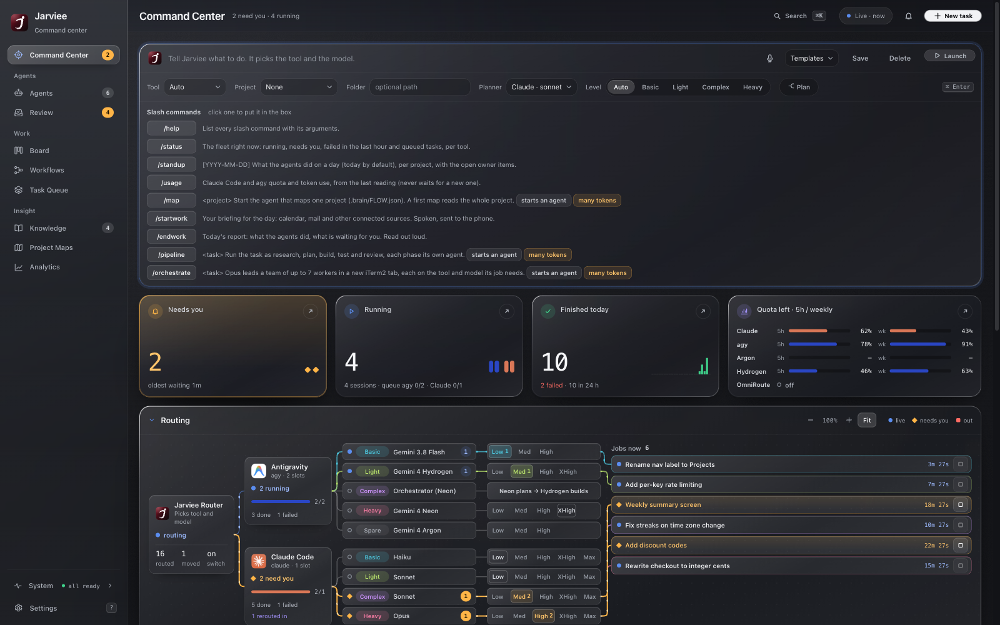

`/startwork` and `/endwork` only use sources you have connected. `/pipeline` and `/orchestrate` always need a task after the command. Without a slash, the text is a normal task and runs as one direct agent.

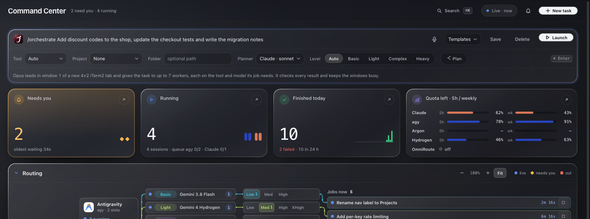

## CLI reference

Run `python3 hub.py <command> --help` for the options of any command. If you installed the `jarviee` launcher, the same commands work as `jarviee <command>`.

**Start and check**

| Command | What it does |
| --- | --- |
| `setup` | First-run wizard: detect your tools, write `~/.jarviee/config.json`, offer hooks (`--yes`, `--dry-run`). |
| `doctor` | Read-only health check (exits 1 when something is broken). |
| `serve` | Start the dashboard and hook receiver on `127.0.0.1`. |
| `install-hooks` | Merge Jarviee hooks into Antigravity / Claude Code config (`--agy`, `--claude`, `--dry-run`, `--uninstall`). |
| `service install \| uninstall \| status \| restart \| logs` | Manage the launchd background service (macOS). |
| `app install \| uninstall` | Create or remove `~/Applications/Jarviee.app` (macOS). |

**Run work**

| Command | What it does |
| --- | --- |
| `classify "<task>"` | Show the level, tool and model a task would get. |
| `run "<task>"` | Launch a task on the matching model (`--tool`, `--tier`, `--project`, `--cwd`, `--wait`, `--inline`, `--single`, `--pipeline`). |
| `plan "<goal>"` | Split a goal into routed tasks and queue them after you say go (`--project`, `--yes`, `--dry-run`, `--planner`, `--json`). |
| `queue` | List plans and queued tasks. |
| `pause` / `resume` | Stop or restart starting new tasks (running ones finish). |
| `retry <id>` | Re-queue a failed, cancelled or blocked task. |
| `reroute <id> --tool claude\|agy` | Send a task to the other tool. |
| `cancel <id>` | Cancel a queued or running task. |
| `orch assign \| wait \| status \| result \| review` | The `/orchestrate` lead's team commands. The lead agent uses these; you rarely do. |

**Projects and reports**

| Command | What it does |
| --- | --- |
| `brain init <project-dir>` | Create a starter `.brain/` in a project (never overwrites; `--force` allows a folder outside the workspace root). |
| `standup [--date YYYY-MM-DD]` | What the agents did today or on a date. |
| `briefing` | What is ahead: calendar, Gmail, LinkedIn, GitHub, WhatsApp (what `/startwork` says). |

**Connectors** (all optional, see [docs/INTEGRATIONS.md](docs/INTEGRATIONS.md))

| Command | What it does |
| --- | --- |
| `connect-gmail <address>` | Store a Google App Password in the Keychain for the briefing. |
| `connect-whatsapp <phone>` | Send summaries to your WhatsApp through CallMeBot (stores its key in the Keychain). |
| `summaries email \| whatsapp \| ntfy` | Choose where the 08:00 schedule, `/startwork` and `/endwork` go. |
| `omniroute status \| connect \| test` | Manage the OmniRoute fallback gateway. |

**The `jarviee` launcher** (`bin/jarviee`, symlink it onto your `PATH`) adds: `jarviee` (start and open the dashboard), `open`, `status`, `stop`, `restart`, `logs`, `glance` (one line: what needs you), `next` (jump to the pane that needs you), `pause`, `resume`, and `--enable` / `--disable` to put Jarviee in or take it out of your setup.

## How routing works

Four levels decide the model. Each level maps to a tool and model in `config.json` → `dispatch`:

| Level | For | Goes to |
| --- | --- | --- |
| basic | renames, typos, formatting, copy, version bumps | agy · `gemini-3.8-flash-low` |
| light | small single-file feature or fix, docs, simple tests | agy · `gemini-4-hydrogen-medium` |
| complex | multi-file feature, non-trivial bug, API/DB change, one-module refactor | claude · `sonnet` |
| heavy | architecture, cross-cutting migration, security/auth, concurrency, hard debugging | claude · `opus` |

The classifier uses keyword lists per level, the length of the brief and how many code files it names. Clauses after "do not", "don't" or "never" are ignored, and every decision comes with its reasons. `standard` is accepted as an alias for `light`.

Rules, in order:

1. `--tool`, `--tier` and the dashboard's selects always win.
2. A missing binary or an exhausted quota sends the task to the other tool, and the task is marked.
3. If both quotas are out, tasks can fall back to a local OmniRoute gateway, when you have enabled it.
4. If an agy run fails or says it is blocked, the task is re-queued once at complex on Claude with the tail of agy's log, marked `escalated`.

Hooks cannot change the model in the middle of a session, in either tool. So the choice happens at launch. Sessions you start yourself in the apps still appear on the dashboard, with the level the router would have suggested.

### Models per tool

When you pick a tool by hand, the level picks that tool's model (`tools.<tool>.models`) and a starting effort (`tools.<tool>.efforts`):

| Level | agy | claude | omniroute (fallback) |
| --- | --- | --- | --- |
| basic | `gemini-3.8-flash-low` | `haiku --effort low` | `claude/combo/jarviee-basic` |
| light | `gemini-4-hydrogen-medium` | `sonnet --effort low` | `claude/combo/jarviee-light` |
| complex | `gemini-pro-orchestrator-neon` | `sonnet --effort medium` | `claude/combo/jarviee-complex` |
| heavy | `gemini-4-neon-high` | `opus --effort high` | `claude/combo/jarviee-heavy` |

Check `agy models` for the slugs your account has; model names change over time, and you can set your own in `~/.jarviee/config.json`.

### Effort

The effort is not fixed to the model. Every task starts at its level's effort and moves one step: reasoning words (debug, race condition, design, migrate) raise it, mechanical ones (rename, typo, bump) lower it. It is then fitted to what the model accepts (`tools.<tool>.effort_levels`). For Claude it is passed as `--effort <level>`; for agy it is part of the model slug (`gemini-4-hydrogen-<effort>`). An effort a model does not have goes to its nearest level. A model you name yourself (`--model`) is never rewritten.

### Queue and `/pipeline`

The scheduler runs two lanes (`lanes`: agy 2, claude 1). A task starts when its dependencies are done and no running task has claimed one of its files. After a plan finishes, one read-only review pass runs over the combined changes.

A task that starts with `/pipeline` runs as separate agents instead of one. In the default config the phases are research (read-only), analysis, plan, build, fact-check and review; the test phase is off. Each phase is a normal run on the dashboard. The skill each phase uses is set in `pipeline.skills`; an empty name means none.

## Dashboard tour

Open http://127.0.0.1:7777. The sidebar has these pages:

**Command Center.** The new-task box with a live router preview, KPI strip (running, needs you, quota), and the fleet at a glance.


**Agents.** Every agent from both tools: status, model, level, steps, activity, Stop, log, and a Changes tab with the run's own diff.

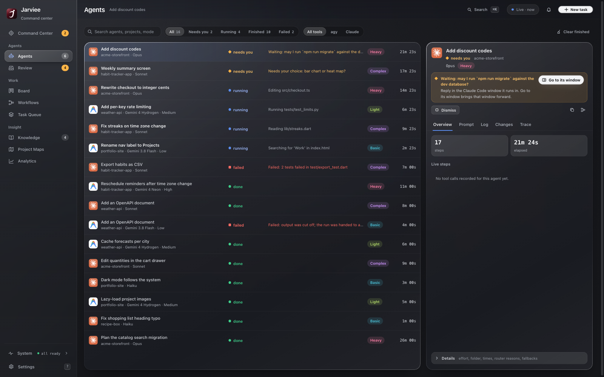

**Review.** The inbox of finished runs: see what each changed, then accept it, revert it or open the agent.

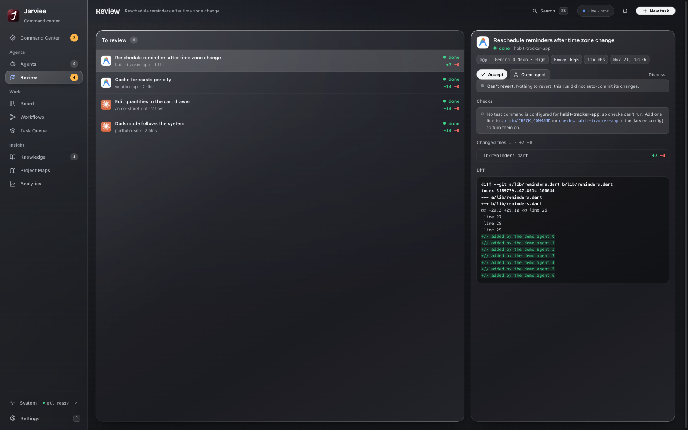

**Board.** A kanban board per project: To do, Plan, Build, Code review, Done. A card linked to a run moves with it.

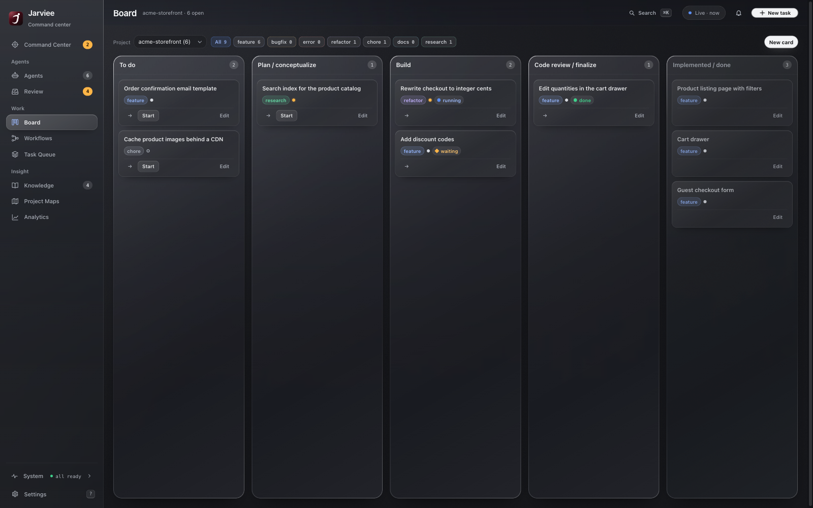

**Workflows.** Plans and `/pipeline` runs as a graph, with the status of each phase. **Task Queue** lists queued tasks and lets you retry, reroute or cancel them.

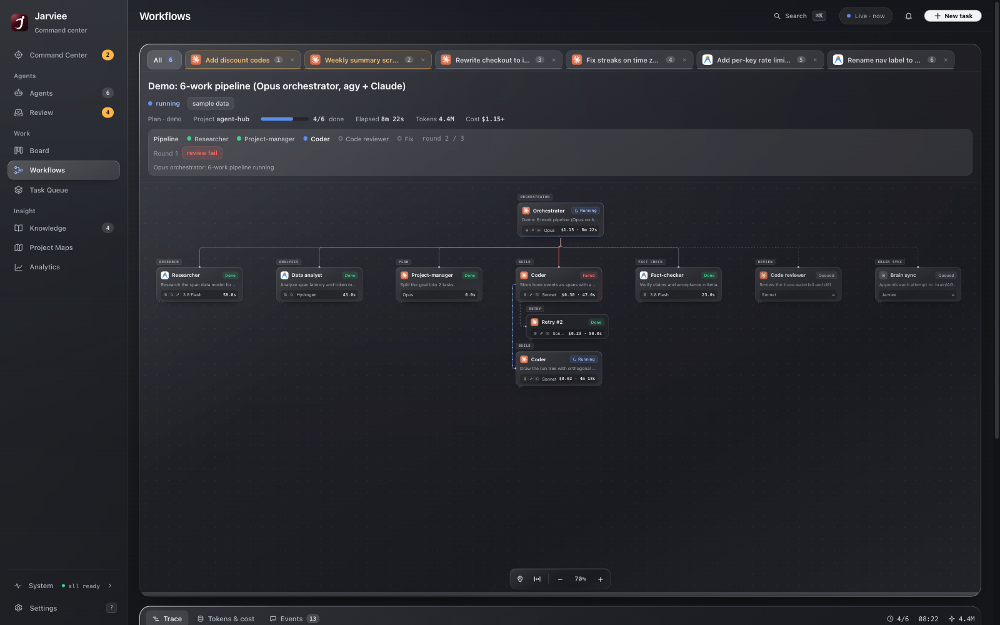

**Knowledge.** Your projects' brains: progress, items that need you, and status.

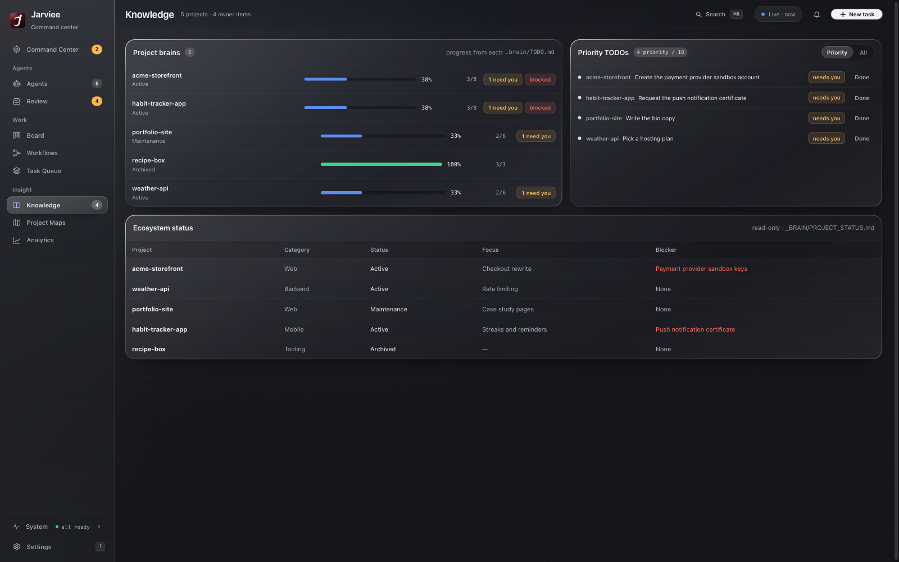

**Project Maps.** The `.brain/FLOW.json` map of each project.

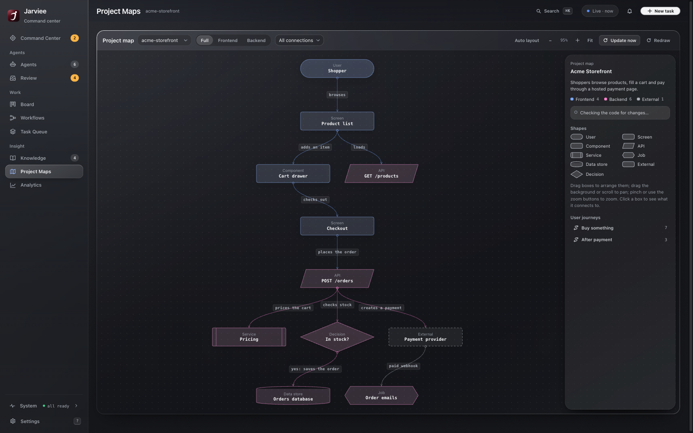

**Analytics.** Tokens and finished runs per hour, Claude Code limits, Antigravity quota and run history.

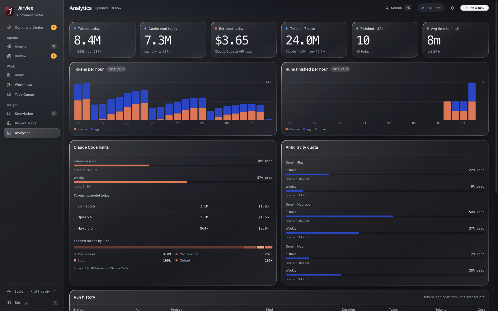

**Settings.** Routing and fallback switches, phone, voice, maps, appearance.

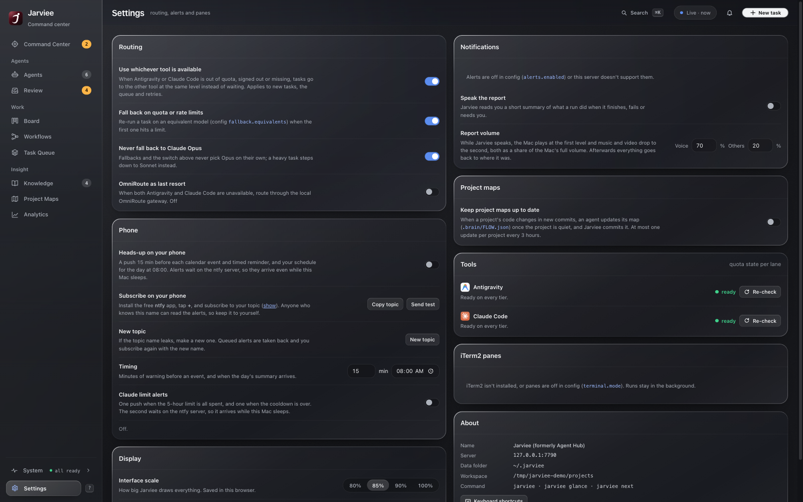

## Optional integrations

Everything here is off by default. Details and setup steps are in [docs/INTEGRATIONS.md](docs/INTEGRATIONS.md).

- **Phone push** through ntfy: alerts for events, agents that need you, and a morning schedule.
- **Gmail briefing** in `/startwork`, read-only over IMAP with a Google App Password kept in the Keychain.
- **Apple Calendar and Reminders** in the briefing and phone alerts.
- **WhatsApp Desktop reader** for the briefing, from the app's local database.
- **Email and WhatsApp summaries** instead of ntfy.
- **Voice**: macOS `say`, or the local Piper / Kokoro voices.
- **OmniRoute** as a last-resort fallback gateway.
- **SwiftBar** menu-bar plugin (`extras/swiftbar`).

## Security and privacy

- The server binds to `127.0.0.1` only, rejects requests from other sites and other `Host` names, and requires a per-install token on every state-changing request. The token is in `~/.jarviee/token` (mode 600).
- Hooks never block an agent: 2 second timeout, errors swallowed, always exit 0.
- Secrets (Gmail App Password, OmniRoute key, CallMeBot key) go in the macOS Keychain, not in files.
- Agents run with auto-approve permission modes. That is the largest risk: see the notice above.

To report a vulnerability, see [SECURITY.md](SECURITY.md). Architecture overview: [docs/ARCHITECTURE.md](docs/ARCHITECTURE.md).

## Uninstall

```bash
python3 hub.py install-hooks --uninstall   # removes only Jarviee's hook entries (files are backed up first)
python3 hub.py service uninstall           # background service (macOS)
python3 hub.py app uninstall               # Jarviee.app (macOS)
rm -rf ~/.jarviee                          # all Jarviee data: config, database, logs, token
```

If you set the Claude Code status line to `hooks/statusline.py`, remove that `statusLine` entry from `~/.claude/settings.json` yourself. Keychain items (`jarviee-gmail`, `jarviee-omniroute`, `jarviee-callmebot`) can be deleted in Keychain Access. Then delete the cloned folder. Project `.brain/` notes and `AGENT_RUNS.md` stay in your projects.

## Troubleshooting

**Start with `python3 hub.py doctor`.** It checks Python, your config and projects folder, the `claude` / `agy` CLIs, hooks, whether the server is running, iTerm2 and the permissions of your data folder, and prints a fix for each problem.

- **The dashboard shows no agents.** The server must be running before the agents start, and hooks must be installed: `python3 hub.py install-hooks`. Restart the agent session after installing.
- **Port 7777 is in use.** Set another port with `JARVIEE_PORT=7790 python3 hub.py serve`, or `"port"` in `~/.jarviee/config.json`.
- **Runs do not open in iTerm2.** macOS must allow it: System Settings › Privacy & Security › Automation → allow your terminal or Jarviee to control iTerm2. Without iTerm2, set `"terminal": {"mode": "background"}`.
- **A task went to the "wrong" model.** Run `python3 hub.py classify "<task>"` to see the reasons, or override with `--tier`. Tune the keyword lists under `classifier`.
- **agy prints nothing in headless mode.** Some agy builds print nothing when stdout is not a terminal. Jarviee notes "no output produced" and re-queues the task on Claude. If `agy-headless-bridge` is on your `PATH`, it is tried first.
- **Everything is slow or the fans spin.** Lower `lanes`, avoid `/orchestrate` on small machines, and turn off `maps.auto_update`.
- **The first map used many tokens.** That is expected: it reads the whole project. Map one project at a time.
- **Something fails silently.** Check `python3 hub.py service logs` (the background service) or the terminal where `serve` runs.

## Tests

Want to see a run without spending anything? The built-in fake `echo` tool launches no real agent and costs no tokens: `python3 hub.py run "hello" --tool echo --inline`. The tests use it too.

```bash
python3 -m unittest discover -s tests -q
```

The tests use fake agent CLIs and temporary directories. They never touch a running Jarviee or your `~/.jarviee`.

## Contributing

Issues and pull requests are welcome. Read [CONTRIBUTING.md](CONTRIBUTING.md) first: the rules are Python standard library only, hooks never block an agent, and the server stays on `127.0.0.1`. Please follow the [Code of Conduct](CODE_OF_CONDUCT.md).

## License

MIT. See [LICENSE](LICENSE). Jarviee is not affiliated with Anthropic or Google.
